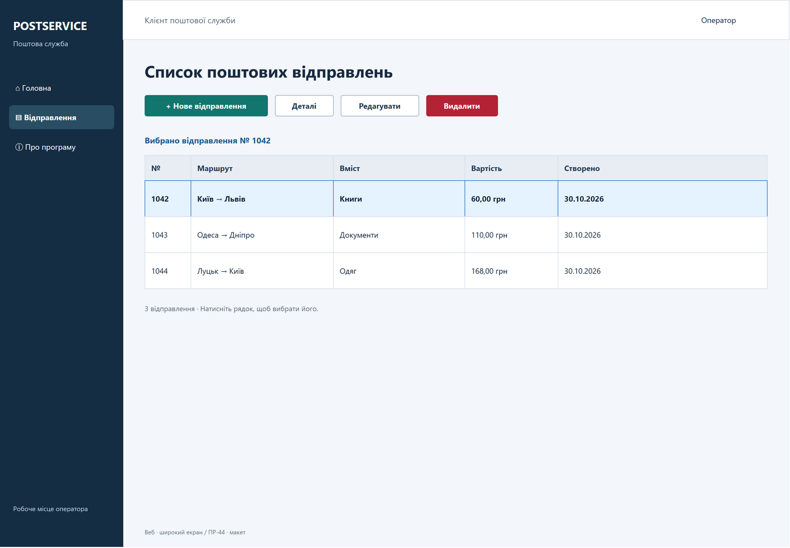

# ПР-44. Побудова графічного інтерфейсу

**24 графічні макети PostService**, експортовані з CASE-засобу **draw.io Desktop 32.6.1** у PNG. Два варіанти клієнта: Windows Forms та адаптивний вебінтерфейс, для якого показані широкий і вузький екрани.

Основна робота — зображення в [screens](screens/). Редагований оригінал із 24 сторінками: [PostService-GUI.drawio](design/PostService-GUI.drawio). Звіт і дев’ять відповідей: [REPORT.md](reports/REPORT.md). Це проєктування інтерфейсу перед реалізацією.

## Галерея екранів

Натисніть PNG у таблиці, щоб переглянути макет у повному розмірі.

| Екран | Windows Forms | Веб: широкий | Веб: телефон |
|---|---|---|---|
| Головна | [PNG](screens/windows-forms/01-home.png) | [PNG](screens/web-desktop/01-home.png) | [PNG](screens/web-mobile/01-home.png) |
| Список відправлень | [PNG](screens/windows-forms/02-list.png) | [PNG](screens/web-desktop/02-list.png) | [PNG](screens/web-mobile/02-list.png) |
| Нове відправлення | [PNG](screens/windows-forms/03-new.png) | [PNG](screens/web-desktop/03-new.png) | [PNG](screens/web-mobile/03-new.png) |
| Форма з помилками | [PNG](screens/windows-forms/04-validation.png) | [PNG](screens/web-desktop/04-validation.png) | [PNG](screens/web-mobile/04-validation.png) |
| Деталі: лише читання | [PNG](screens/windows-forms/05-details.png) | [PNG](screens/web-desktop/05-details.png) | [PNG](screens/web-mobile/05-details.png) |
| Про програму | [PNG](screens/windows-forms/06-about.png) | [PNG](screens/web-desktop/06-about.png) | [PNG](screens/web-mobile/06-about.png) |
| Підтвердження видалення | [PNG](screens/windows-forms/07-delete.png) | [PNG](screens/web-desktop/07-delete.png) | [PNG](screens/web-mobile/07-delete.png) |
| Редагування | [PNG](screens/windows-forms/08-edit.png) | [PNG](screens/web-desktop/08-edit.png) | [PNG](screens/web-mobile/08-edit.png) |

## Приклад широкого вебекрана

## Що передбачено

- Головна веде до списку та інформації про програму.
- Список має створення, редагування, деталі та видалення. Вибране відправлення № 1042 виділено фоном і текстом; на телефоні таблицю замінено картками.
- Форми містять усі бізнес-поля PostingGetDto, включно з габаритами, цінністю, вартістю та описом. Id і CreatedAt показані в деталях як серверні дані.
- На створенні вартість показана як автоматична, відповідно до POST попередньої роботи; під час редагування її можна змінити.
- Помилки показані рамкою, знаком оклику й конкретним поясненням. На широкому екрані — праворуч від поля, на телефоні — під ним. Коректні значення збережені.
- Деталі містять усі 13 полів і кнопку повернення, без елементів редагування.
- Перед видаленням показано номер відправлення, попередження й окремі кнопки «Скасувати» та «Видалити».

## Оригінал і експорт

Відкрити `design/PostService-GUI.drawio` у draw.io Desktop або через **File → Open from Device** у [diagrams.net](https://app.diagrams.net/). Усі написи, поля та кнопки залишаються окремими редагованими об’єктами. Навігаційні кнопки містять посилання між сторінками макета. Стан помилки можна вибрати окремою сторінкою «Нове відправлення · помилки».

PNG експортовано самим draw.io через CLI, по одній сторінці, з параметрами `--format png --page-index N --size page --theme light`. Номери, розміри та шляхи записані в [screens.json](design/screens.json); перевірка комплектності — [verification.txt](reports/verification.txt).

Сторінки показують статичні сценарії з демонстраційними даними. Посилання в оригіналі перемикають макети; вони не виконують збереження чи видалення. Після підтвердження видалення у майбутньому застосунку список має оновитися без видаленого запису.
