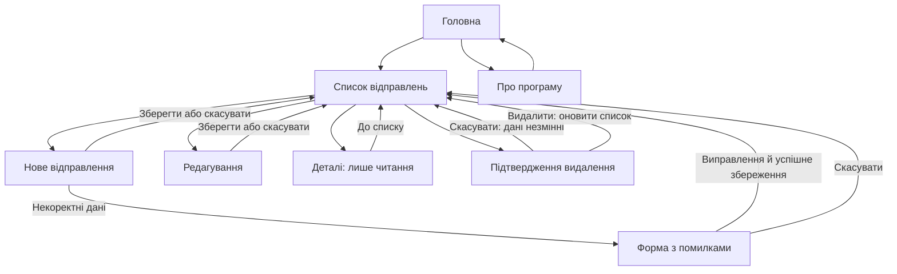

# Звіт. ПР-44 «Особливості побудови графічного інтерфейсу»

## Мета та інструмент

Спроєктувати екрани клієнта поштової служби PostService для Windows Forms і адаптивного вебзастосунку. Обрано draw.io Desktop 32.6.1 як доступний CASE-засіб: він зберігає окремі редаговані елементи екранів, багатосторінковий файл і експортує PNG. Геометрію та написи підготовлено як редаговану модель draw.io; остаточні зображення отримано його штатним експортером.

Результат: 24 PNG — вісім екранів Windows Forms, вісім широких вебекранів і вісім вузьких вебекранів. Восьмий екран редагування додано для повноти сценарію, окрім семи обов’язкових станів. Оригінал — `design/PostService-GUI.drawio`; перелік — `design/screens.json`.

## Відповідність завданню

| Вимога | Рішення в макетах |
|---|---|
| Головна | Дві основні картки: відправлення та інформація про програму |
| Список | Таблиця або картки, вибір № 1042, створення, деталі, редагування, видалення |
| Створення | Відправник, отримувач, вміст, доставка, вага, три габарити, цінність, вартість, опис; «Зберегти» й «Скасувати» |
| Валідація | Порожній отримувач і вага 0, зведення двох помилок, рамки, знаки оклику та пояснення |
| Деталі | Повна інформація про вибране відправлення, лише текст, без полів редагування |
| Про програму | Назва, версія, призначення й доступні операції |
| Видалення | Окремий діалог із номером, маршрутом, попередженням і підтвердженням |
| Адаптивність | Бічна навігація переходить у компактну верхню; таблиця — у картки; поля — в одну колонку |

На новому відправленні серверні Id і CreatedAt не редагуються; вони присутні в деталях. Вартість показана автоматично розрахованою, щоб узгодити дизайн із серверним POST попередньої практичної. Для редагування це доступне поле, як у попередньому PUT. За некоректної ваги розрахована вартість показана як «—».

## Навігація та поведінка

Схема визначає поведінку майбутньої реалізації. На макеті діалогу destructive-дія чітко підписана, а скасування доступне окремою кнопкою. У майбутній програмі кнопка «Деталі» відкриває саме вибране відправлення, а не змінює дані. До вибору запису дії для запису мають бути недоступними; показаний стан містить уже вибраний запис.

Форма перевіряється після натискання «Зберегти». При помилці користувач залишається на ній, бачить зведення і пояснення, введені коректні поля не очищуються. Після виправлення збереження повертає до списку з оновленими даними. Макети не виконують реальних операцій: інтерактивні посилання оригіналу лише демонструють переходи між статичними екранами.

## Узгодженість і доступність

Термін «відправлення» використано на всіх екранах. Збереження виділено основним кольором, скасування — нейтральною рамкою, видалення — червоним і словесною назвою. Вибір запису показано фоном, обведенням і текстом «Вибрано», тому він не залежить лише від сприйняття кольору.

Помилки мають і колір, і знак оклику, і інструкцію: «Укажіть отримувача» та «Вага має бути більшою за 0 кг». На широких екранах пояснення стоять праворуч від відповідного поля; на вузьких перенесені під нього. Підписи полів та одиниці виміру залишаються видимими.

Windows Forms використовує композицію вікна з меню, прямокутними кнопками, таблицею типу DataGridView і діалогом типу MessageBox. Вебваріант використовує бічну навігацію, вебполя, картки й модальне підтвердження. Вузький вебмакет має ширину 430 px; висота відповідає повній сторінці зі звичайним вертикальним прокручуванням. Усі вісім станів показані на цій ширині, а не тільки список.

## Перевірка комплектності

PNG відкрито для візуальної перевірки, зокрема на оглядових аркушах усіх 24 екранів. Перевірено, що поля, пояснення й кнопки поміщаються в сторінку, повний текст деталей доступний, а мобільні елементи розташовані в одній колонці. Файл містить 24 сторінки; для кожної є PNG відповідного розміру. Перевірено існування цільових сторінок для всіх навігаційних посилань і відсутність геометрії за межами аркуша: `verification.txt`.

## Контрольні запитання

1. **GUI та якість продукту.** Графічний інтерфейс — видима частина взаємодії людини з програмою: екрани, кнопки, форми, повідомлення. Якщо операції незрозумілі чи помилки не пояснені, користувач не може ефективно виконати задачу навіть за правильної роботи внутрішнього коду.
2. **Консистентність.** Однакові дії мають однакові назви, вигляд і розташування. Інакше користувач мусить повторно вивчати кожен екран і частіше помиляється. Тут усюди однакові «Зберегти», «Скасувати», «Видалити» й термін «відправлення».
3. **Підтвердження видалення.** Видалення змінює дані й може призвести до їх втрати, тому потрібно перевірити намір і показати конкретний запис. Перегляд деталей нічого не змінює; додаткове підтвердження лише сповільнювало б роботу.
4. **Windows Forms та веб.** Для настільного клієнта природні DataGridView, Button, системний діалог і компонування під монітор. Для вебу потрібні різні ширини, доступні вебполя й модальні вікна; мобільна навігація та форма мають перебудовуватися.
5. **Адаптивність.** Компонування змінюється під доступну ширину. Широкий список показано таблицею, вузький — картками з підписаними значеннями та окремими діями для вибраного запису. Дії не втрачаються й горизонтальне прокручування таблиці не потрібне.
6. **Показ помилок.** Проблемне поле позначається рамкою, іконкою та текстом, що пояснює виправлення. Відмова збереження без причини не дає зрозуміти, яке поле й чому потребує уваги. Коректні дані слід зберегти.
7. **Миттєва валідація та submit.** Перша перевіряє окреме поле після виходу з нього й корисна для спеціальних складних правил. Друга перевіряє всю форму під час збереження та показує помилки разом. Для цих макетів обрано перевірку під час збереження.
8. **Місце помилки та колір.** За умовами завдання на широкому екрані пояснення розміщене праворуч, на вузькому — під полем через обмежений простір. Колір не є достатнім сигналом для людей, які його погано розрізняють; потрібні знак і зрозумілий текст.
9. **Відповідність майбутньої реалізації.** Макет фіксує погоджені рішення: склад полів, назви, навігацію та поведінку помилок. Довільні зміни під час програмування можуть зруйнувати цілісність сценаріїв, тому реалізацію слід порівнювати з цими екранами.

## Джерела

- Умови ПР-44 «Особливості побудови графічного інтерфейсу» — наданий навчальний документ.
- [draw.io Desktop: офіційний CLI експорту](https://github.com/jgraph/drawio/wiki/Desktop-App#command-line-interface).
- [draw.io: експорт PNG](https://www.drawio.com/docs/manual/export/export-to-png/).
